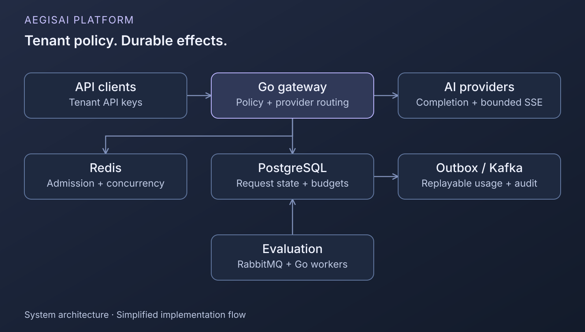

# AegisAI Platform

**Professional experience · Thusney Commerce Group (TCG)**  
Muhammad Rizwan · Software Engineer II

Internal AI gateway and evaluation tooling for tenant-aware provider routing, request controls, usage accounting and asynchronous evaluation at TCG.

## My contribution

Developed gateway request handling, tenant-scoped idempotency, provider routing and budget controls, with separate event and evaluation workflows as part of my TCG role.

- Implement authenticated, tenant-aware AI request workflows.
- Bound provider attempts and coordinate request budgets and usage accounting.
- Separate replayable operational events from asynchronous evaluation jobs.

## System overview

This is a simplified component view for discussing engineering decisions. It omits internal endpoints, configuration and deployment details.

- Authenticated clients submit requests through the gateway.
- Tenant policy, admission controls and budget reservations bound execution.
- Provider routing handles completion and streaming attempts.
- Durable events and queued evaluation work support recovery and inspection.

## A request through the system

1. **Request routing.** The gateway authenticates the client, resolves tenant policy and selects an eligible provider. Stable request identity distinguishes a retry from a new logical request.
2. **Budget protection.** Admission controls bound concurrent work. Durable reservations and usage reconciliation keep request execution tied to the tenant's accounting state.
3. **Failure recovery.** Provider attempts have explicit limits. Durable request state, replayable event delivery and queued evaluation work let interrupted work resume without treating every retry as a new operation.

## Engineering challenges

- Keep one logical request identity across retries and provider attempts.
- Coordinate concurrent usage controls and budget reconciliation.
- Recover asynchronous delivery without duplicating durable effects.

## Design decisions

- Separate durable request/accounting state from short-lived admission controls.
- Keep replayable events and executable evaluation jobs in distinct workflows.
- Bound retries and streaming behavior with explicit lifecycle rules.

## Publication scope

- Internal TCG engineering work; implementation source is confidential.
- The public case study provides a high-level system description, without internal configuration or deployment details.

This repository publishes descriptions and demonstration visuals only. It does not distribute implementation code, customer records or internal configuration.

[Back to the engineering portfolio](../README.md)
