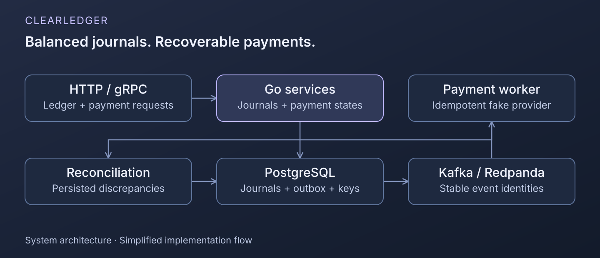

# ClearLedger

**Professional experience · Thusney Commerce Group (TCG)**  
Muhammad Rizwan · Software Engineer II

Internal financial-transaction infrastructure for double-entry journals, idempotent operations, payment workflows and reconciliation at TCG.

## My contribution

Developed ledger and payment workflows around balanced journals, transactional boundaries, stable request identities and recoverable reconciliation as part of my TCG work.

- Model balanced journals and explicit transaction state.
- Handle retries and external delivery with durable request identities.
- Reconcile discrepancies while preserving posted financial history.

## System overview

This is a simplified component view for discussing engineering decisions. It omits internal endpoints, configuration and deployment details.

- Service APIs accept ledger and payment operations.
- Transactional storage commits journal state and durable request identities.
- An event-delivery boundary coordinates external processing.
- Reconciliation workflows retain discrepancies for investigation.

## Engineering challenges

- Preserve financial invariants under concurrent requests and retries.
- Coordinate journal state with asynchronous payment transitions.
- Recover delivery and reconciliation without rewriting posted history.

## Design decisions

- Keep monetary arithmetic and journal invariants deterministic.
- Make durable state the authority for idempotent operations.
- Persist reconciliation discrepancies for investigation.

## Publication scope

- Internal TCG engineering work; implementation source is confidential.
- The public material contains no customer financial data, payment credentials or internal service configuration.

This repository publishes descriptions and demonstration visuals only. It does not distribute implementation code, customer records or internal configuration.

[Back to the engineering portfolio](../README.md)
