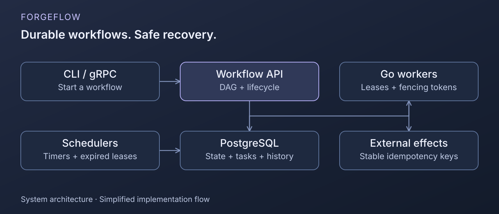

# ForgeFlow

**Professional experience · Thusney Commerce Group (TCG)**  
Muhammad Rizwan · Software Engineer II

Internal workflow-execution infrastructure for durable tasks, worker coordination, retries, timers and crash recovery at TCG.

## My contribution

Developed durable workflow execution, leased workers, task coordination and recovery behavior, keeping external activity retries explicit within my TCG engineering work.

- Model durable workflow, task and timer state.
- Coordinate worker claims and prevent stale workers from committing effects.
- Support retries and recovery across process interruptions.

## System overview

This is a simplified component view for discussing engineering decisions. It omits internal endpoints, configuration and deployment details.

- A workflow API accepts execution requests.
- Durable storage records workflow state, runnable tasks and timers.
- Bounded workers claim tasks using leases and execution ownership.
- Schedulers recover expired work while activities retain stable retry identities.

## Engineering challenges

- Recover work after process failure without accepting stale-worker updates.
- Coordinate concurrent workers and schedulers.
- Make external effects safe to retry after uncertain outcomes.

## Design decisions

- Keep workflow correctness in durable state rather than process-local queues.
- Use leases and ownership checks to bound worker authority.
- Treat activity delivery as retryable work with explicit idempotency boundaries.

## Publication scope

- Internal TCG engineering work; implementation source is confidential.
- The public diagram is a simplified component overview rather than a deployment specification.

This repository publishes descriptions and demonstration visuals only. It does not distribute implementation code, customer records or internal configuration.

[Back to the engineering portfolio](../README.md)
