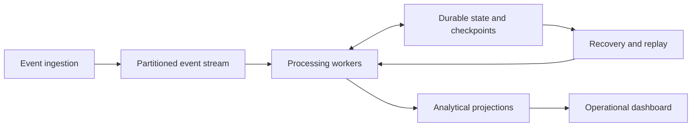
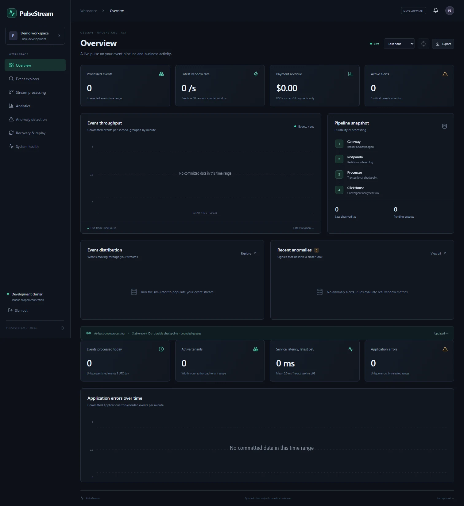
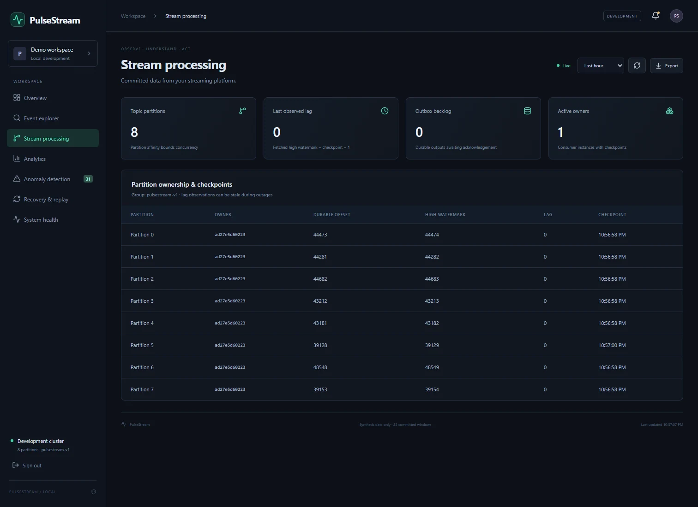

# PulseStream

**Professional experience · Thusney Commerce Group (TCG)**  
Muhammad Rizwan · Software Engineer II

Internal event-processing and analytics tooling for ingestion, partition-aware processing, recovery and operational visibility at TCG.

## My contribution

Developed Go ingestion and processing services, replay and recovery paths, analytical workflows and operational dashboards as part of my TCG engineering work.

- Build event ingestion and partition-aware processing workflows.
- Handle retries, durable checkpoints and replay without duplicating logical results.
- Make pipeline state, analytical views and recovery paths visible to operators.

## System overview

This is a simplified component view for discussing engineering decisions. It omits internal endpoints, configuration and deployment details.

- Ingestion services validate and accept operational events.
- Partition-aware consumers process bounded streams of work.
- Durable state and checkpoints coordinate retry and replay.
- Analytical projections support operational dashboards and investigation.

## Engineering challenges

- Recover interrupted processing without inflating logical results.
- Keep ingestion, durable state and analytical visibility consistent across failures.
- Expose backpressure and replay behavior clearly to operators.

## Design decisions

- Separate accepted events, processing state and analytical projections.
- Persist durable effects before advancing processing checkpoints.
- Use explicit bounds and operational visibility for overload and recovery.

## Demonstration interfaces

### Event-processing overview

Synthetic local demonstration. Values and identifiers illustrate behavior; they are not production customer activity or performance evidence.

### Partition ownership and processing checkpoints

Synthetic local demonstration. Values and identifiers illustrate behavior; they are not production customer activity or performance evidence.

## Publication scope

- Internal TCG engineering work; implementation source is confidential.
- Published interface pictures use synthetic demonstration data and illustrate workflows rather than production customer activity.

This repository publishes descriptions and demonstration visuals only. It does not distribute implementation code, customer records or internal configuration.

[Back to the engineering portfolio](../README.md)
