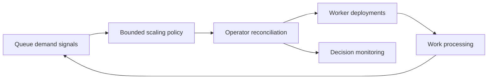
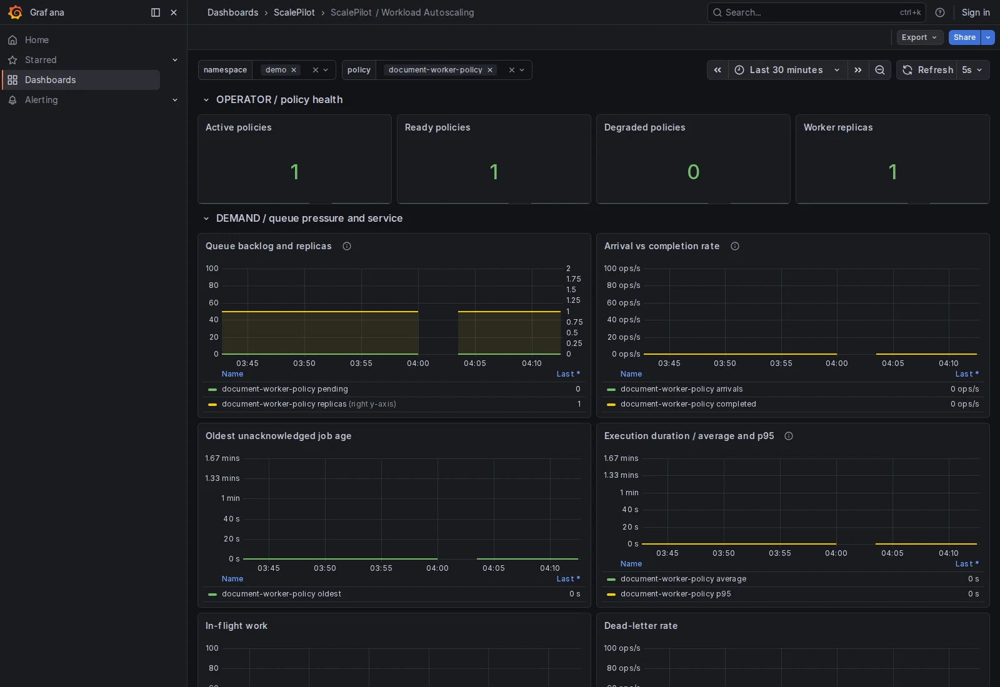
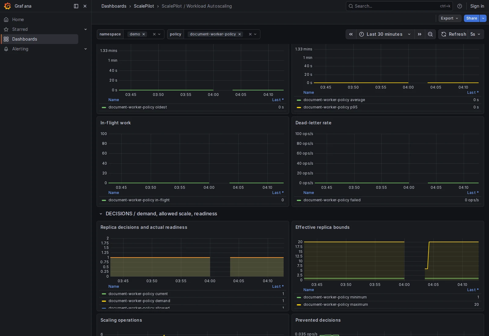

# ScalePilot

**Professional experience · Thusney Commerce Group (TCG)**  
Muhammad Rizwan · Software Engineer II

Internal Kubernetes worker-scaling and operational tooling for queue pressure, worker coordination and controlled scaling decisions at TCG.

## My contribution

Developed scaling policy, worker coordination and operational visibility, separating scaling decisions from infrastructure interaction as part of my TCG engineering work.

- Use queue backlog and work age to inform worker scaling.
- Apply coordination and ownership checks around scaling operations.
- Expose policy decisions, worker state and recovery behavior through monitoring.

## System overview

This is a simplified component view for discussing engineering decisions. It omits internal endpoints, configuration and deployment details.

- Queue and workload signals describe pending demand.
- A scaling policy evaluates worker capacity and safety boundaries.
- The operator reconciles desired worker deployment state.
- Monitoring views expose scaling decisions and workload behavior.

## Engineering challenges

- React to queued demand while keeping scaling decisions bounded.
- Coordinate reconciliation ownership across failures.
- Explain policy behavior through useful operational signals.

## Design decisions

- Separate deterministic scaling policy from infrastructure I/O.
- Use ownership and admission checks for distinct coordination boundaries.
- Keep decision inputs and outcomes observable.

## Demonstration interfaces

### Workload and worker monitoring

Synthetic local demonstration. Values and identifiers illustrate behavior; they are not production customer activity or performance evidence.

### Scaling decisions and readiness

Synthetic local demonstration. Values and identifiers illustrate behavior; they are not production customer activity or performance evidence.

## Publication scope

- Internal TCG engineering work; implementation source is confidential.
- Monitoring pictures are synthetic local demonstrations, not production capacity or performance claims.

This repository publishes descriptions and demonstration visuals only. It does not distribute implementation code, customer records or internal configuration.

[Back to the engineering portfolio](../README.md)
